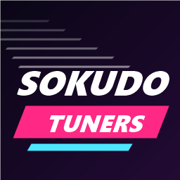

# Sokudo Tuners



Arcade car tuning for Schedule I. Nitro, a racing speedometer and a full tuning garage with upgrades saved per car. Driving should be fun, not realistic.

Successor to my older mod VNitro, rebuilt from scratch.

## Features

- **Nitro** - install a nitro kit in the garage, then hold Left Shift to boost. Blue exhaust flames, an FOV kick, a tank that drains and refills, and a Shift prompt that lights up while it fires.
- **Racing speedometer** - a round gauge with a needle and a curved nitro bar. Unlike the stock one it doesn't freeze at high speed.
- **Sokudo Tuners shop** - Marco's auto shop at the downtown gas station is now Sokudo Tuners, with a neon sign, pink and cyan lighting and a glowing bay. Open 24/7, with its own pin on the map.
- **Drive-in garage** - drive into the shop and a cutscene rolls your car into the bay, then the tuning menu opens with an orbit camera, before/after stat bars and sounds. Leave and it drives you back out onto the street. Or talk to Marco with your car parked inside.
- **Five upgrade categories**, each with Stock / Street / Sport / Race tiers:
  - Engine: acceleration and top speed
  - Tires: traction and cornering grip
  - Suspension: stiffer springs and more downforce
  - Brakes: stopping power
  - Nitro: None / Street / Sport / Race. Cars start without nitro.
- **Upgrades are saved per car** with your save game.
- mph by default, switch to km/h in the garage.

Upgrades are free for now. Prices may come in a later update.

## Controls

| Key | Action |
|---|---|
| Left Shift | Nitro (once a kit is installed) |
| *drive in* | Open the garage at Sokudo Tuners |
| F4 | Open / close the garage while parked in the shop |
| Space / Enter | Skip the drive-in and drive-out cutscenes |
| W/S or ↑/↓ | Choose a part |
| A/D or ←/→ | Choose a tier |
| Enter / Space | Install |
| U | Switch mph / km/h |
| Esc | Close the garage |

## Requirements

- Schedule I on the **alternate (Mono)** beta branch. Right-click the game in Steam > Properties > Betas. It won't load on the default IL2CPP branch.
- [MelonLoader](https://github.com/LavaGang/MelonLoader.Installer/releases/latest) 0.7.3

## Install

With r2modman or the Thunderstore app, just install it.

Manually: put `SokudoTuners.dll` in `Schedule I\Mods`.

## Notes

- Built and tested in single player.
- Upgrades are saved in `SokudoTuners.txt` inside your save folder, so removing the mod never breaks a save.
- Settings are in `UserData\MelonPreferences.cfg` under `[SokudoTuners]`:
  - `TuneAnywhere = true` lets F4 open the garage anywhere instead of only at the shop.
  - `DebugLogging = true` logs 0-60 / 60-0 times in the console (and also allows tuning anywhere).
- Marco stays at his shop around the clock while the mod is installed.

## Building from source

Needs the .NET SDK and the game installed with MelonLoader.

```powershell
.\build.ps1             # builds and copies the DLL into the game's Mods folder
.\package.ps1           # Release build + Thunderstore zip in dist\
```

If the game isn't at `F:\SteamLibrary\steamapps\common\Schedule I`, change `GamePath` in `SokudoTuners.csproj` or pass `-p:GamePath="..."`.
